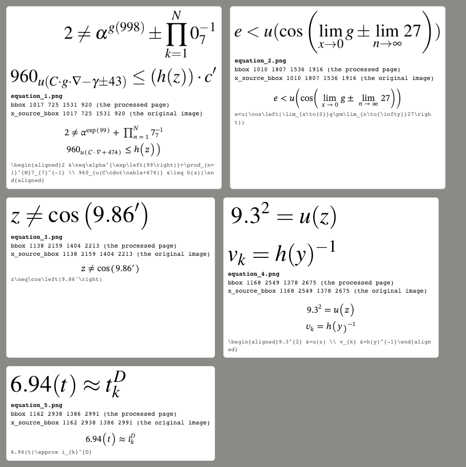
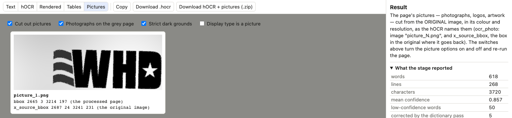
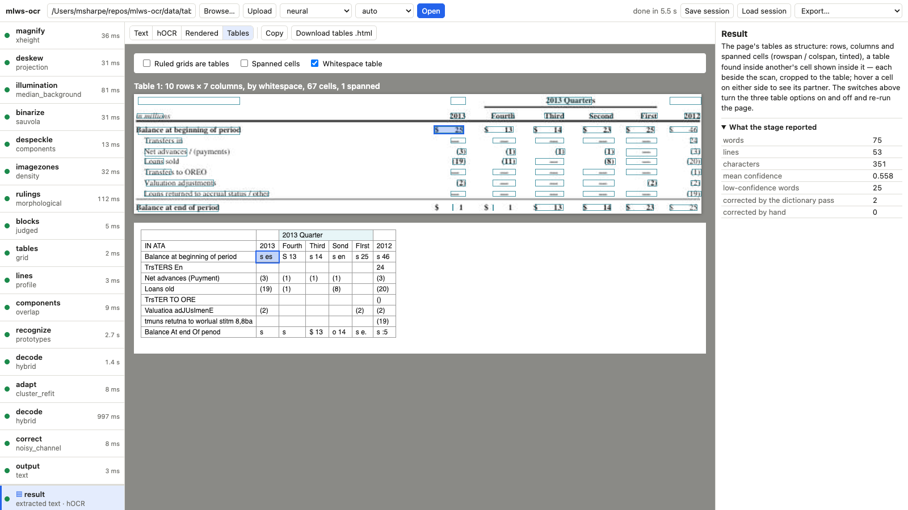
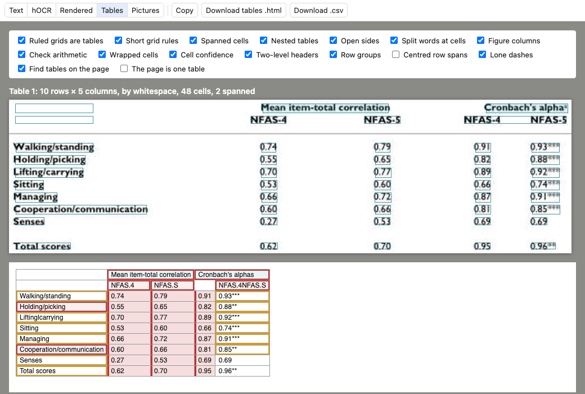
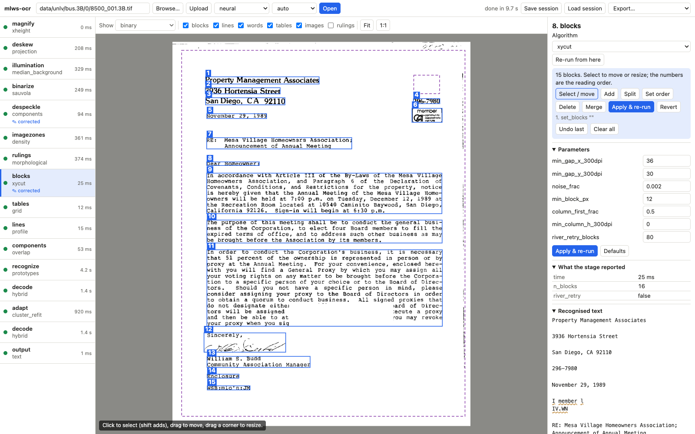
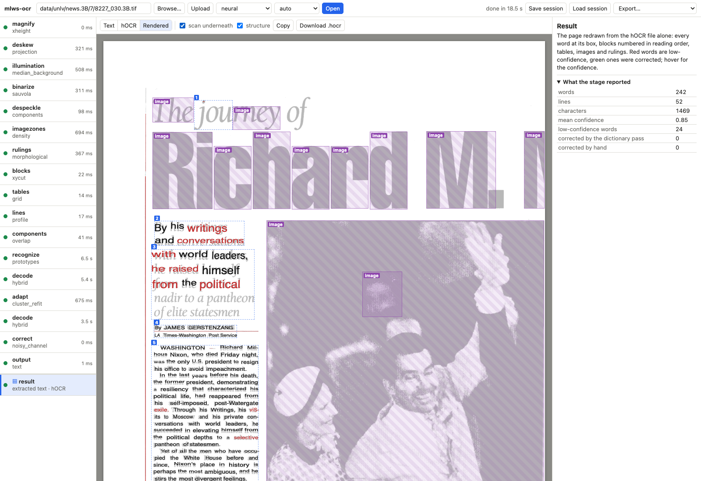

# mlws-ocr

A **readable OCR** for real-world scanned documents, in two engines that
share one pipeline: a **classic** feature-based engine — the reference
implementation Tesseract's legacy engine should have been — and a
**neural** engine that adds networks to it one measured term at a time:
a word-strip scorer, a line reader, a per-line judge.

**Every model is trained here.** No pre-trained weights, no vision or
language foundation model. Each network is small enough to read (the
largest, the table sequence reader, has 1.88M parameters), trains
from public data on a home computer (a Mac, or a gaming PC's graphics
card) in an hour to about a day, and runs locally from one exported
`.npz`. [docs/DEV_ENVIRONMENT.md](docs/DEV_ENVIRONMENT.md) describes the
machines, the training times and the energy: none of it needs a data
centre.
[docs/NEURAL_NETWORK_THEORY.md](docs/NEURAL_NETWORK_THEORY.md) teaches
the theory from a single neuron up and draws each network's shape and the
reasons for it; `docs/NETWORKS.md` records what each is for, how its
training data is acquired and how it is trained.

**Code legibility is a deliverable.** Small stages, explicit features, a
debug rendering for every step, and a research log that records where
each algorithm comes from and what it measured — including everything
that did not work.

> **Please read the numbers below with care.** This project set out to beat
> Tesseract, and on the evaluation sets below it now does on most kinds of
> document. But it is a new project: a few weeks old, English only, with no
> real-world users, no production deployments and no track record outside
> the pages it has been measured on. Every comparison here is our own
> measurement — on sets we chose, with scripts we wrote, by the people who
> built the engine — while Tesseract has decades of use on millions of
> documents in many languages. Treat these results as a laboratory report,
> not a guarantee: the sets are small and the numbers move by a point or
> more with the choice of pages; an engine tuned while being measured can
> flatter itself however carefully held-out pages are kept apart; and
> documents unlike ours — other scanners, languages, layouts, real handwriting —
> have not been tried. Check any claim that matters to you on your own
> documents before relying on it
> ([docs/MEASUREMENT.md](docs/MEASUREMENT.md) explains how every number is
> produced, and [docs/DATA_SOURCES.md](docs/DATA_SOURCES.md) how to
> reproduce them), and please tell us where it fails.

## Results

Character / word accuracy on real scanned pages, September 2026. Legacy
Tesseract (`--oem 0`) is the reference, measured with the same scripts on
the same pages; the LSTM column is Tesseract 5.5.3 with its default English
model; bold marks the row's leader. The held-out rows are pages no tuning or
layout decision has used (`eval_unlv.py --heldout`,
`eval_tesseract.py --heldout`), but **not** pages kept from training: the
readers' line harvests excluded only the evaluation draws, and every
held-out letter, legal and newspaper page and 24 of the 30 magazine pages
lent lines to training (audit of 2026-10-13,
[the system paper](docs/papers/readable-self-trained-ocr.md) §6.1). The two
*clean* rows are UNLV sets the project had never opened: no decision and no
training has touched them. They are scored pooled over the set's characters,
because many DOE pages are figures whose truth is only the caption. Receipts are out of scope for now: the
engine targets documents from business-quality printers and screenshots,
and photographed or thermal receipts wait for a profile of their own
(`docs/ROADMAP.md`); their measurements stay in `docs/RESEARCH.md`. The full
scoreboard and its history are in `docs/DESIGN.md` §8.

| set | what it is | classic | neural | legacy Tesseract | Tesseract LSTM |
|---|---|---|---|---|---|
| dev-8 | UNLV business letters, tuning set | 95.2 / 89.4 | **97.9 / 96.3** | 95.0 / 91.7 | 95.5 / 93.1 |
| broad-30 | UNLV business letters, the headline set | 91.9 / 82.3 | 95.8 / **93.1** | 95.5 / 91.7 | **96.0** / 92.7 |
| legal-8 | UNLV legal pleadings (typewriter) | 91.7 / 81.3 | **95.0 / 91.8** | 90.4 / 88.7 | 90.3 / 86.9 |
| modern | born-digital PDFs and templated business letters | 91.6 / 83.5 | **94.4 / 91.4** | 75.4 / 70.8 | 74.2 / 66.6 |
| business | invoices, payslips, receipts, statements, purchase orders | 95.3 / 86.1 | **98.3 / 97.5** | 70.7 / 68.0 | 70.7 / 68.6 |
| news-8 | UNLV newspapers (the layout rules were tuned here) | 94.2 / 84.1 | **97.5 / 95.3** | 96.3 / 93.1 | 96.7 / 94.8 |
| mag-8 | UNLV magazines (the layout rules were tuned here) | 66.8 / 45.5 | 85.0 / 78.8 † | 87.3 / **84.7** | **87.8** / 84.4 |
| newspapers, held out | 30 UNLV newspaper pages held out from decisions (not from training) | 76.5 / 63.4 | **89.4 / 86.3** | 87.1 / 82.4 | 87.7 / 84.2 |
| magazines, held out | 30 UNLV magazine pages held out from decisions (not from training) | 68.3 / 50.7 | **84.5 / 77.8** | 77.9 / 71.3 | 78.5 / 73.6 |
| letters, held out | 30 UNLV business letters held out from decisions (not from training) | 90.7 / 83.1 | **94.3 / 92.1** | 92.4 / 88.8 | 93.1 / 90.6 |
| DOE reports, clean | 30 UNLV DOE technical reports never opened before (no hint, pooled) | 83.5 / 68.9 | 86.2 / **79.5** | 86.0 / 76.2 | **86.6** / 77.5 |
| annual reports, clean | 30 UNLV annual reports never opened before (no hint, pooled) | 66.5 / 53.1 | 77.9 / 76.9 | 84.3 / 83.3 | **86.1 / 84.6** |
| funsd | real scanned forms, FUNSD, at 2x | 37.4 / 12.7 | **67.8** / 46.4 | 54.8 / 32.0 | 66.4 / **47.2** |
| legal reports | real typescript and printed office pages, Library of Congress | 70.5 / 47.3 | **89.2 / 77.7** | 57.5 / 42.8 | 78.8 / 66.3 |
| blocks | a paragraph handed in alone, no layout (broad-30's text zones) | 94.4 / 85.8 | **98.7 / 97.4** | 98.2 / 96.6 | 98.5 / 96.5 |

The neural column is v0.18.22 (18 October 2026): v0.18.19's line readers,
which learned the receipts' letters without their case, report pages read
in their sections and statements read row by row by their figures (v0.18.20),
and small images of small type enlarged and declared 300 dpi (v0.18.21: every
full-page row above unchanged; FUNSD 47.0 → 46.4 word by the page mean, 46.3 →
46.7 pooled; the scanned receipts lose 2 words in a hundred and photographed
ones read as junk -- receipts and photographs are not this engine's documents),
and a two-page book spread cut at its spine (v0.18.22: every row above unchanged). On an outside
benchmark, Omni Parse Bench's English printed pages (its test half: 698 pages
never developed on, measured once), v0.18.21 passes 49.3% of the text tests
to Tesseract 5.5.3's 43.0% (40.0% before v0.18.21), 16.4% of the table tests
(Tesseract makes no tables) and 63.7% of the layout tests to 50.3%
(v0.18.22: 49.3%, 16.4% and 63.4%; the test half holds no two-page spread;
v0.18.23, tables read with the table networks: 48.9%, 19.8% and 73.7%).
† One page of the eight (8011_012) has its right-hand column clipped by the
scanner and left out of UNLV's truth zones; the new readers read it and every
word is scored as an insertion. Without that page mag-8 is level (86.0 / 79.4
before, 86.2 / 79.7 after). news-8 had the same kind of page (8229_028) at
v0.18.18; these readers read it as v0.18.17's did.


**Tables.** Table structure is scored by TEDS (tree-edit similarity of the
recognised tables to their HTML truth, text included; after the slash,
TEDS-S, structure alone; 1.0 is perfect), read with `neural-table` and
the classic profile with the same options:
ruled grids kept from the picture zones, short grid rules, spanned cells,
open sides, nested tables, words split at cell borders, figure columns, and tables found
on the page (the generated sets, scored page-wide over every table) or the
`table` hint (FinTabNet's single-table crops, magnified from 72 dpi).
The neural-table column adds the self-trained table networks: a detector, a
structure network, a word-relation network, a table sequence reader and a
reader for table lines. Neither Tesseract engine outputs table
structure -- its text, hOCR and TSV carry no rows, columns or cells -- so
there is nothing to score. With the options off, every set scores
between 0.00 and 0.03.

| set | what it is | classic | neural-table |
|---|---|---|---|
| payroll forms | generated ruled payroll forms: spanned headers, two-row records, open sides; software, typewriter and hand-lettered entries (20 pages) | 0.600 / 0.854 * | **0.913 / 0.939** |
| paystubs | generated: earnings and deductions nested in the stub, in five rule styles from full grid to whitespace (20 pages) | – | 0.940 / 0.952 |
| invoices | generated: line items with spanned totals, five rule styles (20 pages) | – | 0.967 / 0.981 |
| timesheets | generated: two-level spanned headers, five rule styles (20 pages) | – | 0.942 / 0.964 |
| annual-report tables | real financial tables, FinTabNet.c, ruled by whitespace (60 tables; on 240 held-out ones 0.881 / 0.930) | 0.607 / 0.781 | **0.857 / 0.905** |
| scientific tables | real tables from papers, PubTables-1M test crops (60 tables; on 240 held-out ones 0.879 / 0.940); page-level detection F1 0.967 at IoU 0.5 (40 pages, v0.17.2) | – | 0.886 / 0.951 |
| screenshots | tables drawn as web pages by a browser -- plain, grid, zebra, dark mode, coloured header, spreadsheet -- at 96 and 192 dpi (80 tables) | – | 0.906 / 0.938 |

Neural-table as of v0.18.14 (2026-10-12: nil dashes read, a receipt's paper edge dropped, receipt item rows kept apart, a frame round a table's crop not taken for the table, light-grey rules found in the grey page, captions and notes trimmed by whole rows, wrapped cells read line by line, row labels spanning their sub-rows, a word read across a column gap split, a table reader that writes ± and the tables' other symbols, a small transformer over a table crop's words whose table a fitted choice keeps when it is the better, a reader for table crops trained harder on table lines, light text on a dark ground inverted, row labels with dot leaders kept, photographs found on the grey page and kept out of that inversion, pictures cut out for the hOCR, wrapped cells read line by line within their column, lone '-' dashes kept, a row's label spanning its continuation rows, a second reader lending its dashes and signs to a table's text, dashes named by measure and a symbol classifier trained on real glyphs, a two-level header rebuilt from its text lines, a calibrated confidence for every cell, a heading above a table's figures put back, centred headings and short spanners seen in two-level headers, a table-crop reader trained on 781k more table lines with the per-table choice refitted on 1,615 unseen tables, a table sequence reader that reads a crop's grid from its pixels, its table kept where a fitted choice prefers it, a cell's words kept in reading order where a descender splits a line, a row of check marks not taken for a note; scored from the output's table records since 2026-10-07 -- docs/RESEARCH.md); the generated sets' truth was corrected where it disagreed with its own images (timesheets, payroll forms). \* measured before the open-sides and short-rule options and before the payroll truth held both amounts of each diagonal gross cell (the set was regenerated, 2026-09-28); – not measured.

**Held-out pages.** The eight-page sets flatter newspapers and magazines:
on 30 fresh pages of each type, never used for any decision (though their
lines were among the readers' training harvests), the neural
profile reads newspapers at 89.4 / 86.3 and magazines at 84.5 / 77.8 (v0.18.19 and v0.18.20; 89.3 / 86.0 and 83.9 / 75.9 at v0.18.18, 89.1 / 85.6 and 83.8 / 75.7 at v0.18.16; with
the per-page segmenter judge on those two types since 26 September 2026,
and since v0.18.16 lines re-split on columns set solid, a column read through where
the XY-cut parts it, and headlines joined (newspapers 86.7 / 81.6 before);
XY-cut alone read them at 79.7 and 65.9; magazines 68.1 before text-row protection
and 77.1 before deskew stopped trusting an estimate at its search limit, which had
rotated three straight photo-heavy pages by 5 degrees). Letters (94.3), legal pages
(94.6) and a freshly rendered business set (97.5) hold up. Tesseract LSTM
on the same held-out pages: newspapers 87.7 / 84.2, magazines 78.5 / 73.6,
letters 93.1 / 90.6 (neural 94.3 / 92.1).
`scripts/eval_unlv.py --heldout` draws them. On two UNLV sets no decision
and no training has touched (30 pages each, no hint, pooled), the neural
profile is level with the LSTM on DOE technical reports (86.2 / 79.5 against
86.6 / 77.5; 85.5 / 77.8 before the larger readers) and behind it on annual reports (77.9 / 76.9 against
86.1 / 84.6; 75.0 / 73.3 at v0.18.19, before sections and statements were read
in their order). The paper measured 72.2 / 68.4 there at v0.18.16, with two-column
report pages read line by line across their gutter
([the system paper](docs/papers/readable-self-trained-ocr.md) §7); since v0.18.17
a page with no hint has its columns found from the whitespace gutters and, with
two or more, is segmented as a newspaper (held-out newspapers read with no hint
70.8 → 82.4). A reverse-video page still reads as nothing: the inversion that
reads it is an option, off, since it cost a held-out magazine page 36 points.

**Larger readers on real printed lines (15 October 2026).** A capacity
pilot found the line reader limited more by its real data than by its size,
so the Library of Congress printed campaigns were read with the engine and
their human transcriptions kept the lines it got right: 31,170 grey lines
from the Legal Reports and from African American Perspectives in Print,
a collection of printed pamphlets. Three readers
four times the old size (1.10M parameters) were trained from scratch on the
old mix and these lines, with the line-choice judge refitted on their own
readings. Legal Reports went 87.0 / 72.7 -> 88.9 / 77.2, dev-8 95.4 -> 96.5
words, photographed receipts 3.7 words, forms 1.7, the held-out rows
0.2 to 0.6. Two costs. One news-8 page whose right-hand column the scanner
clipped now has that column read, and the truth leaves it out (news-8
95.4 -> 93.9 words; level or better without that page). The synthetic regression page
also fell 100 -> 94 characters: set in Verdana, a face no training set draws, its
lowercase lines are read in capitals. The old readers began from a network
that had seen 3,179 Google Fonts faces, and these did not, so a second round
trained with those faces' lines and 18,695 more printed ones.

**Receipts that taught capitals (17 October 2026).** The second round did
not cure the capitals, and neither did a curriculum, distillation or lighter
receipt weights. Looking at the receipts did: SROIE transcribes every
receipt in capitals, and many are printed in mixed case ('Cash Bill ...
Goods Sold are non-refundable'), so 30,000 of its lines taught the readers
to read small letters as capitals. The readers now learn those lines as
partial labels (Cour, Sapp & Taskar 2011): before the loss each small
letter's probability is added to its capital's, so the receipts teach their
letters but not their case (`train_seq.py --caseless sroie`). Three readers
trained this way, with their own judge (v0.18.19), read the Verdana page
clean again (severity 1: 94.2 -> 99.9 characters), and the real sets rose
with it: legal-8 91.4 -> 91.8 words, business 96.7 -> 97.5, held-out magazines
75.9 -> 77.8, letters 91.7 -> 92.1, forms 46.4 -> 47.0, Legal Reports 77.2 ->
77.7, clean DOE 78.8 -> 79.6, and news-8's clipped page read as before
(93.9 -> 95.3). dev-8 gave back 0.2 words and mag-8 has a clipped page of its own
(†). SROIE's own score now counts the print's case as wrong: 63.4 -> 48.5
words as scored, 72.5 -> 72.6 with case folded (`eval_unlv.py` prints both).

**Report pages in their order (17 October 2026).** On annual reports the
engine read the words well and the pages in the wrong order. Two kinds of
page lost most of it. On one, two-column sections are separated by a table
or figure across the page, and the gutter runs on through it, so each column
was read down through the table. On the other, a financial statement's
label column was read whole before the figures. v0.18.20 cuts across a
gutter's foot first, beside prose columns only: a form's labels and values
or a receipt's items and prices stand beside a gap as wide as themselves,
and are read row by row (`blocks.gutter_sections`). It also joins a column
of figures to the label column whose lines share its baselines, read row by
row (`output.align_figures`, T-Recs' row step keyed on the figures). On 60
development report pages: 79.9 / 76.5 -> 83.8 / 80.8 pooled, 17 pages up and
none down (the LSTM 84.7 / 82.5). Receipts now read each price on its
item's line (CORD 59.1 -> 61.6 pooled characters); every other text set reads
byte for byte as before. On the 30 clean annual reports, measured after the
decision: 75.0 / 73.3 -> 77.9 / 76.9 (nine pages up by 2 to 33 points, one
down 1.1).

**Photographs and the facing page (27 September 2026).** Photographs no
longer cost text (0.3% of the text's ink falls in picture zones), but a
scanned spread often holds a strip of the facing page along the edge, and
every word read there is an insertion against the page's truth. Its column
is recognisable -- lines running off the image, words cut mid-word -- and is
now left out on newspaper and magazine pages: mag-8 81.4 -> 87.2, news-8
95.4 -> 96.9 (ahead of Tesseract's LSTM on characters), fresh magazines 82.1 /
73.2 -> 83.7 / 75.6 (ahead of it on both).

**Reading a paragraph (27 September 2026).** Handed a paragraph with no
layout to find, the engine now reads more of its words right than either
Tesseract engine (98.6 / 97.2 against 98.5 / 96.5). Error typing against
Tesseract's LSTM found four fixes: a rule that re-joins letter-spaced
display type had been joining '3 x 5' into '3x5'; a sentence-case pass had
lowercased capitalised words the reader read right ('President', 'Board');
the dictionary lacked contractions ('we'll', 'you'll'), so an apostrophe
lost to 'well' and 'were'; and the reader could not write * = + @ [ ] _ `.

**Receipts (27 September 2026).** The line reader has now also trained on
the annotated lines of SROIE's training receipts and FUNSD's training forms,
and on twice the typewritten Legal Reports lines. To keep it from
forgetting how it read everything else, it was held to the previous reader
while it learned: its weights by L2-SP, and its character-by-character
readings by Learning without Forgetting (distillation from the previous
reader), and the running average of its weights is what ships. SROIE went
68.2 / 47.6 -> 78.6 / 60.2; nothing outside receipts dropped more than
0.4 word. The capitals the receipts taught still show on clean sans-serif
text, so a case-repair pass mends 'Iong' and 'DOg' (why the receipts taught
capitals was found only on 16 October: their truth is in capitals).

**Magazines and forms (26 September 2026).** Three fixes found by looking
at the worst pages. The picture-zone stage had swallowed magazine captions
and photo-side columns; rows of glyphs that chain like text are now given
back (held-out magazines 68.1 -> 77.2). On forms, rows of underline dashes
had set the page's x-height to 3.6 px, and every all-caps line was then
deleted as a scanner sliver; and dashed or fax-broken underlines, which the
solid-rule finder missed, garbled the text resting on them. Photographed
receipts went 46.4 / 21.7 -> 52.4 / 30.6 and forms 63.5 -> 66.1.

**The grey-strip reader (26 September 2026).** The line reader now reads
each line from the flattened grey page, contrast-stretched, instead of
from the binarised one: binarisation had been erasing faint thermal and
dot-matrix strokes before the network ever saw them. Photographed
receipts rose 8.7 characters and 13.7 words, forms 5.7 / 8.2, the Legal
Reports 2.1 / 4.3, SROIE 3.9 words; legal-8 gave back half a point.

On the tabular business pages Tesseract reads by column and pays the
edit distance for the order; there, the bag-of-words recall is the
recognition comparison (neural 97.7, legacy 97.5). Real forms — 72-dpi
faxed scans — are hard for every engine and are where the text work is;
`docs/TESSERACT.md` has the detail. The whole run of
measurements, and every mechanism that was tried and turned down, is in
`docs/RESEARCH.md`.

## Against Tesseract

Both Tesseract engines are measured on every set with the same scripts
and pages; [docs/TESSERACT.md](docs/TESSERACT.md) is the full side-by-side
of the numbers, the shared ideas and the differences. The short form:

- **Ahead of both engines** on the headline letter set in words (93.1
  against 91.7 legacy and 92.7 LSTM; 0.2 characters behind the LSTM), on
  held-out letters (94.3 / 92.1), typewriter pleadings (+4.7 characters),
  modern documents (+19), tabular business pages (+27), the Library of
  Congress typescript archive (+10.4 characters / +11.4 words over the LSTM)
  and a paragraph read alone. Tesseract's page analysis is much of the
  reason on the documents: margins and hole punches read as text,
  templated letters broken, tables read by column.
- **Ahead on held-out newspapers since v0.18.16** (89.4 / 86.3 against the
  LSTM's 87.7 / 84.2), after a fix found on other newspaper pages: columns
  set solid whose lines fused, columns the XY-cut parted, headlines cut into
  letters. Held-out magazines lead (84.5 against 78.5), and news-8 since
  v0.18.19 (97.5 / 95.3 against 96.7 / 94.8).
- **Behind** on forms in words (FUNSD: 67.8 / 47.0 against 66.4 / 47.2; ahead in
  characters since v0.18.18), on mag-8 in words (one clipped page, †), and on the
  one clean set with multi-column pages: UNLV annual reports, never opened
  before, 77.9 against 86.1 characters (72.2 before v0.18.17 found columns
  without a hint, 75.0 before v0.18.20 read sections and statements in their
  order). Level on clean DOE reports (86.2 against 86.6
  characters, ahead in words). The
  held-out rows above were held out from decisions, not from training.
- **A tenth of the training data**: readers of 1.1M parameters (287k in the
  table profile) trained on
  this machine from open fonts and public scans, against Tesseract's 4,500
  fonts and Google's training run. Real scanned strips in training are
  what buy the lead on degraded pages.

## Quick start

```sh
python3 -m venv .venv && .venv/bin/pip install -e ".[dev]"
.venv/bin/python scripts/fetch_models.py                      # the released model files into data/, SHA-256 checked
.venv/bin/pytest                                              # every stage against synthetic ground truth
.venv/bin/python scripts/make_demo_page.py                    # a degraded demo scan
.venv/bin/mlws-ocr run configs/neural.toml demo_page.png      # read it (writes text.txt and page.hocr under runs/)
.venv/bin/mlws-ocr run configs/neural.toml scan.pdf --pdf-page 0
.venv/bin/mlws-ocr run configs/neural.toml paragraph.png --doc-type block   # the image is one block of text
.venv/bin/mlws-ocr run configs/neural-table.toml paystub.png  # a table document (writes tables.json, .html, .csv)
.venv/bin/mlws-ocr-ui scan.png                                # the interactive workbench at http://127.0.0.1:8330
.venv/bin/mlws-ocr inspect                                    # browse persisted runs (read-only)
.venv/bin/mlws-ocr batch configs/neural.toml scans/ --out out/  # many pages at once, one per worker process
.venv/bin/mlws-ocr-service --config configs/neural.toml       # POST an image to http://127.0.0.1:8340/ocr (JSON; ?format=hocr, text or zip)
.venv/bin/mlws-ocr-lab data/unlv/bus.3B                       # live segmentation lab at http://127.0.0.1:8801
```

`--doc-type` is an optional layout hint (`letter`, `legal`, `book`,
`form`, `newspaper`, `magazine`, `block`, `table`); the engine never requires it.
Every run writes `text.txt` and `page.hocr` — hOCR with the page's
structure (blocks in reading order, lines, words with boxes and a
calibrated probability each, tables, image zones, rulings) — beside the
persisted page. In the neural profiles (and with `--set output.pictures=true` in any) each picture (a photograph, a logo) is also
cut from the original image as `picture_N.png`, and its `ocr_photo` names
the file and its box in the original, so it can be put back
([docs/HOCR.md §6](docs/HOCR.md)). The service returns
the same as JSON, one page per worker process, so a machine with N cores
reads about N pages at once (`scripts/service_load.py` is its load test).
`mlws-ocr batch` does the same for files, directories and whole PDFs: 16
UNLV letters take 185 s on one worker and 29 s on thirteen (33 pages a
minute on a 14-core Mac mini), with text, hOCR and a `batch.json` summary
per run.

The full usage reference — choosing a profile, what `run` and `batch`
write, the service's JSON, `--doc-type` and `--set`, which inputs work —
is [docs/USAGE.md](docs/USAGE.md).

**Tables.** A page's tables come out as structure, not only as text:
`tables.json` (each table's rows, columns and cells with rowspan, colspan,
box and text, header rows marked, each cell's column and row header
path, a table inside another's cell nested under that cell), `tables.html` (the same as `<table>` markup),
`tables.csv`, and `ocr_table` in the hOCR. The neural profile finds ruled
tables from their rules (spanned cells, open sides, tables nested in a
frame) and tables set by whitespace or ruled only between rows anywhere
on the page; it reads a column of figures as figures ('S 25' → '$ 25')
and checks each table's arithmetic (quantity × price = amount, a row's
day columns against its total, column totals),
marking the cells a failed check points at. Since v0.18.23 neural also
finds and reads tables with the self-trained table networks: a table
detector over the whole page (its tables refused where their cells are
prose), a structure network that gives a table's rows, columns and extent,
a separator network that joins a table's wrapped rows, a word-relation
network (a small transformer over a table's words), a table sequence reader
that reads a table's grid from its pixels, and a confidence for every cell.
Where a network builds a table of its own, a small fitted choice keeps its
table or the rules'. For table documents, `configs/neural-table.toml` adds
the options that cost text on ordinary pages: a large ruled grid kept from
the picture zones, short dividers under spanned headers, low-dpi crops
magnified, rules taken out of the reader's strips, figure columns re-read
with digits only, readers and a symbol classifier trained on table lines. A table image on its own reads best with `--doc-type table`. Measured by TEDS
against HTML truth (`scripts/eval_tables.py`), table by table in the
comparison above.

Training the sequence models is faster with the optional extra
(`pip install -e ".[train]"`, torch on the machine's own GPU); the numpy
implementation of every model is the reference, and the pipeline never
imports torch unless asked to.

## The workbench

`mlws-ocr-ui [IMAGE]` opens a page in the browser and runs it through the
whole pipeline, then lets you revisit any stage: see what it did (its
images, numbers and overlays), pick another algorithm or change its
parameters, correct it by hand, and re-run from there — upstream stages
are kept, downstream ones re-run. Corrections are data, saved with the
session and re-applied on every re-run:

- **deskew** — the stage's estimate beside the angle applied; type an
  angle, or click two points along a line of text;
- **noise** — tune the despeckle size, click a mark to erase it, click a
  removed speck to restore it, drag a box to clear;
- **blocks and lines** — select, move, resize, add, delete, split, merge,
  and click the blocks in reading order;
- **text** — click a word on the page or in the text panel to correct
  it; the text and hOCR are rebuilt;
- **tables** — add or remove a column or row line, merge cells, type a
  cell's text, draw a table the page missed or delete one; the tables'
  JSON, HTML and CSV are rebuilt, the text left as read;
- **post-processing** — the learned-dictionary pass's corrections, each
  clickable on the page, and its on/off switch.

The last tab is the **result**: the extracted text, the hOCR source, the
tables (rows, columns and spanned cells), or
the page **rendered from the hOCR file alone** — every word at its box,
blocks numbered in reading order, tables, images and rulings, low-
confidence words in red and corrected ones in green, optionally over a
faint copy of the scan or side by side with it (hovering a word marks
its box on the scan). It shows at a glance what the file carries and
what the page lost (a line never read, a headline taken for a picture).

**Pictures** — photographs, logos, artwork — have a view of their own in
the result tab: each one cut from the **original** image, in its colour,
with its box on the processed page and `x_source_bbox`, its box in the
original, where it goes back. The rendered page puts each picture back at
its box, from the files the hOCR names. Switches turn the picture options
on and off and re-run the page (cutting them out, photographs found on the
grey page, strict dark grounds, display type as a picture), and
"Download hOCR + pictures" gives the hOCR with its `picture_N.png` files
in one zip ([docs/HOCR.md §6](docs/HOCR.md)).
In the neural profiles (since v0.18.5) display equations in scientific pages
are found before reading: each is cut out the same way (`equation_N.png`) and
written as hOCR's `ocr_display` / `ocr_math`, its number '(3)' read as text --
F1 0.906 on fresh typeset pages, none found on business, letter, legal,
newspaper or magazine pages. Since v0.18.9 each equation is also READ by a
small self-trained network into LaTeX (in the layout JSON) and MathML (in the
`ocr_math`): since v0.18.10 (the v3 reader, a beam of eight) 61.1% of
equations exact, 88.2% of tokens on 30 held-out typeset pages. Since v0.18.14
a two-line equation is read line by line (`output.math_split_lines`), and
the reader confirms a centred line the finder could not call (no number, no
fraction bar) on a page with numbered equations (`output.math_display_logp`).
Since v0.18.15 the reader (v4) also reads matrices, cases and accents, the
finder keeps a matrix's columns and a case's conditions with their equation
(`lines.equations_beside`), and a pair numbered line by line is cut between
its numbers (`output.math_split_at_numbers`): 86.1% of equations exact and
97.3% of tokens on 60 fresh typeset pages (85.4% / 97.4% on the 30), 72.6% /
95.7% on 60 pages full of matrices, cases and accents; finding F1 0.967 on
the fresh article pages; text pages unchanged. The Pictures view shows each equation cut out, drawn from its MathML,
with its LaTeX beneath ("Read equations" turns it off).





**Tables** get their own view in the result tab: each table beside the scan
cropped to it (above it, for a wide table), rows, columns and spanned
cells tinted, a nested table inside its cell; hover a cell on either side
to see its partner. Each cell's calibrated confidence is shown too: amber to review, red to reject, the value on hover. Switches above it turn the table options on and off
and re-run the page -- ruled grids kept from the picture zones, short
grid rules, spanned cells, tables found on the page (set by whitespace or
ruled only between rows), a page that is one table, wrapped cells read
line by line within their column, and lone '-' dashes kept -- and the tables
stage lists what it found. On the page view, ruled tables are drawn solid, whitespace ones
dashed, each labelled with its size.





Sessions save to a `.mlws.json` file (image, profile, every choice and
correction) and reload; the page exports as text, hOCR, page JSON, the
cleaned image, the hOCR with its pictures (a zip), or the session's settings as a profile TOML. Standard
library server, plain JavaScript and canvas, no build step
(`src/mlws_ocr/workbench/`).





## Engines

One codebase, five profiles under `configs/`; pass one to `mlws-ocr run`
or to any evaluation script's `--config`. `default.toml` is the classic
profile, kept as the reference; the neural profile is the accurate one.

| profile | config | networks | role |
|---|---|---|---|
| **classic** | `configs/classic.toml` | the MLP second opinion (53k) and the character GRU (258k) | the feature engine: nearest-prototype, outline and MLP channels over explicit glyph features, a beam decoder with lexicon and language model, per-document adaptation. Its row is the regression guard after every neural adoption. |
| **pure** | `configs/pure.toml` | none | classic with both networks off; what the feature engine reads on its own |
| **neural** | `configs/neural.toml` | classic's, plus the word-strip CRNN+CTC scorer as the judge of the classic word variants, the line reader (every line read end to end by the line model), the fitted judge that decides each line between the two readings, the word-confidence calibrator, the segmenter judge (newspapers and magazines) and the equation reader (855k) | the engine to use; finds and reads tables with the table networks (since v0.18.23; detected tables refused where they are prose), spans, nesting, figure columns, arithmetic checks |
| **neural-table** | `configs/neural-table.toml` | neural's, with a line reader fine-tuned on table lines in place of neural's (and on a table's crop a reader trained harder on table lines, a symbol reader and a symbol classifier); the table networks as neural (separator, detector 248k, structure 277k, word relations 321k, sequence reader 1.88M, their fitted choices, cell confidence), the detector's tables never refused as prose | neural plus the table options that also change what the reader sees (ruled grids kept from the picture zones, short grid rules, low-dpi crops magnified, rules taken out of the reader's strips, figure columns re-read as figures, turned cell text read): for payroll forms, paystubs, statements, invoices, receipts, and tables from reports and papers |
| **neural-line** | `configs/neural_line.toml` | the same, as the experiment profile for a new line model or choice rule | development |

`tests/test_profiles.py` keeps the profiles honest (pure differs from
classic only in the two network switches; neural in the recognize and
decode terms, the segmenter judge, the word corrector's switch, and the
table, picture and equation options that leave the text alone), and `tests/test_regression.py` reads the synthetic
page under each profile against the accuracies recorded at adoption.

## Models and data

All models live under `data/` (gitignored). Every release ships them as
one asset, `mlws-ocr-models-v<version>.tar.gz` with a manifest naming
what each file is and its SHA-256; `scripts/fetch_models.py` downloads
and verifies the set for the version in `pyproject.toml`. They are built
by the scripts in this repository, from three public sources: text rendered from the
pinned font stock and any directory of open fonts (the Google Fonts
checkout gives 3,179 faces past the shape gate), the UNLV/ISRI
ground-truth scans with a guard that keeps every evaluated page out of
every harvest, and a public-domain text corpus (Project Gutenberg plus US
federal text). [docs/DATA_SOURCES.md](docs/DATA_SOURCES.md) says where to get each
dataset and where it goes under `data/`; `docs/NETWORKS.md` has the full
account per model; the short form:

```sh
.venv/bin/python scripts/build_langmodel.py data/corpus_en_plus data/lang_en.npz   # lexicon + character trigrams
.venv/bin/python scripts/train_charlm.py --corpus data/corpus_en_plus              # character GRU language model
.venv/bin/python scripts/build_prototypes.py data/prototypes.npz --condense 90     # glyph prototypes (renders + harvests)
.venv/bin/python scripts/build_prototypes.py data/pool_all.npz --cap 1000000000 --inlier 100 && .venv/bin/python scripts/train_mlp.py data/pool_all.npz data/mlp.npz
.venv/bin/python scripts/build_outline_protos.py data/outline_protos.npz --condense=12 --min-cover=0.85
.venv/bin/python scripts/make_seq_data.py --out data/seq_synth_v1.npz --n 250000  # synthetic word windows, touching pairs included
.venv/bin/python scripts/harvest_lines.py data/unlv/bus.3B --pages 170 --out data/lines_en.npz --line-out data/linesfull_en.npz
.venv/bin/python scripts/train_seq.py --backend torch --synth data/seq_synth_v1.npz --lines data/lines_en.npz --out data/seq_en_vN.npz
.venv/bin/python scripts/harvest_word_conf.py data/unlv/bus.3B --pages 60 --config configs/neural.toml && .venv/bin/python scripts/train_wordconf.py data/wordconf_en.npz
# the table networks: make_det_data.py + train_tabledet.py (detector), make_split_data.py + train_splitnet.py (structure),
# train_table_select.py (the rules-or-network choice), harvest_boxes.py --tables (the table reader's lines),
# train_wordrel.py + train_wordrel_select.py (word relations), make_tableseq_data.py + train_tableseq.py +
# train_tableseq_select.py (the table sequence reader), make_math_set.py + train_mathread.py (equations);
# recipes in docs/NETWORKS.md
```

A trained network goes live only when it clears the seed-to-seed range
of its recipe on the evaluation sets, or wins with two seeds; the live
file changes only on adoption, and the measurement is recorded either
way.

## Measurement

```sh
.venv/bin/python scripts/eval_unlv.py data/unlv/bus.3B --pages 30 --seed 2 --doc-type letter --config configs/neural.toml   # a UNLV set (broad-30)
.venv/bin/python scripts/make_modern_set.py && .venv/bin/python scripts/make_business_set.py   # today's documents; tabular business pages
.venv/bin/python scripts/eval_unlv.py data/business/sev0 --pages 60 --seed 1 --by-kind --config configs/neural.toml
.venv/bin/python scripts/eval_blocks.py truth data/unlv/bus.3B --pages 30 --seed 2 && .venv/bin/python scripts/eval_blocks.py score data/unlv/bus.3B --pages 30 --seed 2 --config configs/neural.toml
.venv/bin/python scripts/eval_blocks.py zones data/unlv/bus.3B --pages 30 --seed 2 --config configs/neural.toml   # where on the page the errors sit
TESSDATA_PREFIX=... .venv/bin/python scripts/eval_tesseract.py data/unlv/bus.3B --pages 30 --seed 2 --oem 0    # the legacy reference, same pages
.venv/bin/python scripts/eval_tables.py data/tables/paystub --pages 20 --whole-page --config configs/neural-table.toml   # a generated table set, every table on the page
.venv/bin/python scripts/eval_tables.py data/tables/fintabnet --pages 60 --doc-type table --config configs/neural-table.toml --set output.ws_table_doc_types=table --set magnify.min_dpi=150
.venv/bin/python scripts/eval_detection.py data/raw/pubtables1m/x --pages 40 --config configs/neural-table.toml   # tables found on scientific pages
```

Character and word accuracy by edit distance, plus order-free word
recall and precision; line-end hyphenation is folded on both sides and
character rule lines are dropped, so an engine is not scored on a
convention. Every run can save its per-page output (`--dump`) and
`scripts/rescore_dump.py` re-scores it under a changed convention in
seconds.

## Architecture

The pipeline is a sequence of **slots** (magnify, deskew, illumination,
binarize, despeckle, image zones, rulings, blocks, tables, lines,
components, recognize, decode, adapt, decode, correct, output), each filled by one of possibly
many registered **implementations**, chosen per run by a TOML config.
Every stage takes a `Page` and returns a new `Page` plus a `DebugBundle`
(images, scalars, notes); the runner persists both at every stage
boundary under `runs/<doc-id>/`, and the inspector is a dependency-free
local viewer over that tree. The full design — every stage, why it is
shaped that way, the three recognition channels, the decoder's priors,
the line reader, the models and how we measure — is in
[docs/DESIGN.md](docs/DESIGN.md); the diagrams (packages, stage contract,
pipeline, profiles, where each model plugs in, the tables subsystem, the
runtime surfaces, training and release) are in
[docs/ARCHITECTURE.md](docs/ARCHITECTURE.md).

```
src/mlws_ocr/
  core/       Page artifact, Stage contract, registry, TOML config, runner, PDF and image I/O
  cleanup/    magnify, deskew (projection | Hough), illumination, binarize (Sauvola | Otsu), despeckle
  layout/     image zones, rulings, blocks (XY-cut | k-NN SCC | whitespace | judged), tables, lines;
              whitespace and mesh table finders, display equations found; the table separator, structure,
              detector and word-relation networks, the table sequence reader, the segmenter judge
  glyph/      connected components and cuts, the 95-element feature vector, skeletons, line strips
  recognize/  nearest-prototype, MLP and outline channels; the CRNN sequence model (numpy + torch mirror) and CTC
  lang/       lexicon and character trigrams, the character GRU
  math/       display equations: the LaTeX grammar, the equation reader (CNN + GRU with attention), MathML
  decode/     the beam decoder, its post-passes and sequence-scorer terms, numeric formats and shape repairs, the line reader, the judge, word confidence, the word corrector, text, hOCR and table output
  adapt/      per-document cluster refit
  factory/    synthetic data: font stock, glyph and line rendering, the degradation model, the table generator
  eval/       alignment of output to ground truth
  inspector/  the run browser and the segmentation lab (stdlib http.server + static HTML)
  workbench/  the interactive workbench: a session of per-stage snapshots, user corrections, its server and page
  batch.py    many files or a PDF's pages in a process pool
  service.py  the HTTP service (process pool, one page per worker)
configs/      classic.toml (= default.toml), pure.toml, neural.toml, neural-table.toml, neural_line.toml, and layout variants
scripts/      builders, trainers, harvesters and evaluators (91 Python scripts and 3 shell scripts; each says what it is for)
tests/        every stage against synthetic ground truth; profile structure; regression on the synthetic page
```

The **segmentation lab** (`mlws-ocr-lab`) re-runs block segmentation live
as parameters change and draws the algorithm's inner state — every
component box, every k-NN link kept or pruned, the computed threshold,
the resulting blocks — to settle "why did these blocks come out this
way?" by looking.

## Documentation

**New here? Start with [docs/START_HERE.md](docs/START_HERE.md)** — a path through the engine from pixels to text, with the teaching pages below in reading order.

- [docs/DESIGN.md](docs/DESIGN.md) — what the system is and why each part is shaped the way it is; the scoreboard.
- [docs/ARCHITECTURE.md](docs/ARCHITECTURE.md) — the system in diagrams: packages, the stage contract, the pipeline, what a page carries, the profiles, where each model plugs in, decoding, tables, runs on disk, the service, the workbench, training and release.
- [docs/NEURAL_NETWORK_THEORY.md](docs/NEURAL_NETWORK_THEORY.md) — neural networks from a single neuron up, then every network in the engine: its job, its exact shape and why, its training, with pictures of the real networks at work.
- [docs/BINARIZATION.md](docs/BINARIZATION.md) — from grey pixels to ink and paper: Otsu and Sauvola, flattening the light, scanner frames, dim photos, despeckle, and why the line reader reads grey.
- [docs/SKEW_CORRECTION.md](docs/SKEW_CORRECTION.md) — finding how far a page is turned (projection profiles, Hough) and turning it back; the ways the search was fooled, and the fixes.
- [docs/SEGMENTATION.md](docs/SEGMENTATION.md) — pictures and rules out, then blocks (RLSA, XY-cut, whitespace rectangles, k-NN + SCC, the per-page judge), reading order, lines, and how segmentation is measured.
- [docs/TABLES.md](docs/TABLES.md) — table extraction: ruled grids from their rules, unruled tables from their words and the junction mesh, the table networks, reading and checking cells, the output records, TEDS.
- [docs/RECOGNITION.md](docs/RECOGNITION.md) — glyph recognition in the classic engine: the 95 shape features, nearest prototypes, the outline channel (Tesseract's matcher re-derived), skeleton graphs, how the opinions combine, where it fails.
- [docs/DECODING.md](docs/DECODING.md) — from candidates to words: the beam decoder and its priors, language models, numbers, the neural readers and the judge, adaptation to the page, the noisy-channel corrector.
- [docs/USAGE.md](docs/USAGE.md) — using the engine: the profiles, `mlws-ocr run` and `batch`, the HTTP service and its JSON, the options, which inputs work.
- [docs/HOCR.md](docs/HOCR.md) — the output with its geometry: what hOCR is, exactly what the engine writes (blocks, lines, words with calibrated confidence, tables), the coordinate frame, reading it, searchable PDFs.
- [docs/SYNTHETIC_DATA.md](docs/SYNTHETIC_DATA.md) — drawing our own pages with the answers known: the degradation model, fonts, training windows, generated test sets, scanner calibration, and what synthetic data could not do.
- [docs/MEASUREMENT.md](docs/MEASUREMENT.md) — how accuracy is computed, the evaluation sets, held-out pages, seed variance and the bootstrap, adoption rules, and the numbers that turned out to be wrong.
- [docs/NETWORKS.md](docs/NETWORKS.md) — every network and learned model: purpose, data, training, rebuild order.
- [docs/DEV_ENVIRONMENT.md](docs/DEV_ENVIRONMENT.md) — what the project runs on: a Mac mini and two gaming PCs, what each does, training times and energy, the free software, and how to do it with less.
- [docs/DATA_SOURCES.md](docs/DATA_SOURCES.md) — every dataset and document source: what it is, its licence, where to download it, where it goes under `data/`, what it trains or measures.
- [docs/TESSERACT.md](docs/TESSERACT.md) — mlws-ocr against Tesseract's legacy and LSTM engines: the numbers, what is the same idea, what differs and why.
- [docs/RESEARCH.md](docs/RESEARCH.md) — the provenance of every algorithm (papers, deviations, code) and the measurement behind every decision, negative results included. Nothing lands without an entry.
- [docs/ROADMAP.md](docs/ROADMAP.md) — where the work stands and what comes next, ranked by measured evidence.
- A paper on the directional k-NN + SCC block-segmentation algorithm
  ([rendered](https://msharpe248.github.io/mlws-ocr/docs/papers/knn-scc-block-segmentation.html),
  [markdown](docs/papers/knn-scc-block-segmentation.md)).
- Its follow-on, taking the method beyond the 1995 specification: XY-cut
  reading order, gutter evidence and a tree of strong components, with
  tuned, trained and held-out measurements
  ([rendered](https://msharpe248.github.io/mlws-ocr/docs/papers/knn-scc-beyond-1995.html),
  [markdown](docs/papers/knn-scc-beyond-1995.md)).
- The system paper: the whole engine, how its self-trained networks enter as
  measured terms, the comparison with both Tesseract engines, and an audit of
  which pages were really held out
  ([rendered](https://msharpe248.github.io/mlws-ocr/docs/papers/readable-self-trained-ocr.html),
  [markdown](docs/papers/readable-self-trained-ocr.md)). The other papers are
  listed in [docs/papers](docs/papers/README.md).

## Licence

MIT (see [`LICENSE`](LICENSE)): the code, the documentation and the model
files released with each version. The evaluation and training datasets the
project downloads (UNLV, SROIE, FUNSD, CORD, FinTabNet.c, PubTables-1M, the
Library of Congress pages and others) are not part of the repository and
keep their own licences; `docs/NETWORKS.md` names each source.

## Where the work stands

The neural profile leads both Tesseract engines on letters (in words),
typewriter pleadings, modern documents, business pages, the Library of
Congress typescripts, a paragraph read alone and, since v0.18.16, the
held-out newspapers; it trails the LSTM on forms in words, where form
structure is the open problem, and on UNLV annual reports, a set no decision
or training had touched (77.9 against 86.1; 72.2 before v0.18.17 found columns
without a hint, 75.0 before v0.18.20 read report sections and financial
statements in their order). On the other clean set, DOE reports, it is level. The
line reader's data was the focus until v0.18.19: since v0.18.18 neural reads with three readers four
times the old size trained on real printed lines from the Library of
Congress (49,865 since v0.18.19), and since v0.18.19 they learn the SROIE
receipts' lines without case, whose all-capitals truth had taught the readers
to read small letters as capitals. v0.18.20 took up the annual reports' gap:
two-column sections read before the table spanning the page beneath them, and
financial statements read row by row by their figures (60 development pages
79.9 -> 83.8 characters, the LSTM 84.7). The system paper
([docs/papers/readable-self-trained-ocr.md](docs/papers/readable-self-trained-ocr.md)) is measured at v0.18.20, with the
clean sets followed release by release from v0.18.16. Tables were the focus
before ([docs/TABLES.md](docs/TABLES.md)): the generated business
sets read at 0.91-0.97 TEDS, real financial tables at 0.88 and scientific
tables at 0.88 (on tables no decision looked at). Receipts are parked for a
receipt profile of their own.

The small items left on the text side were measured and closed or
recorded as residuals (the masked card numbers and the touching words on
bare blocks resisted the last honest mechanism); every such result, won or
lost, is in [docs/RESEARCH.md](docs/RESEARCH.md).
